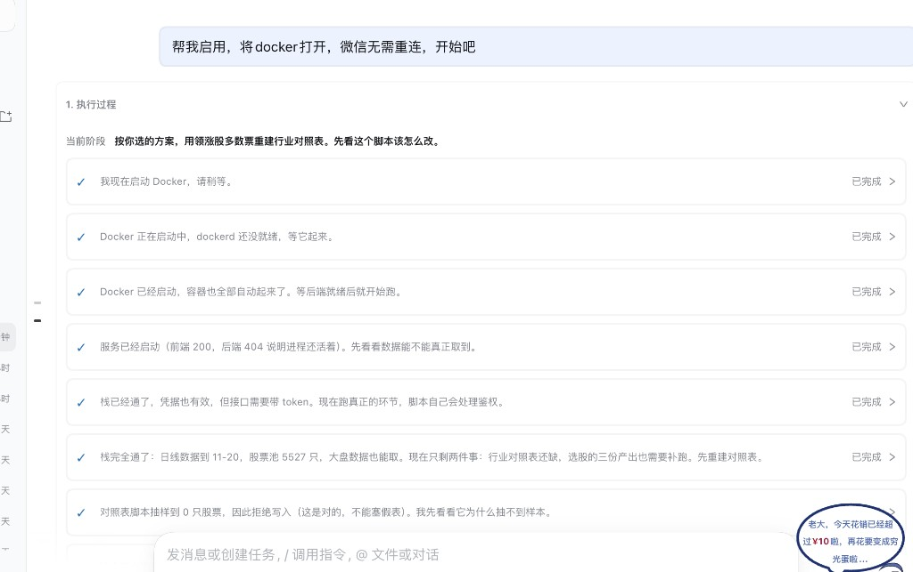
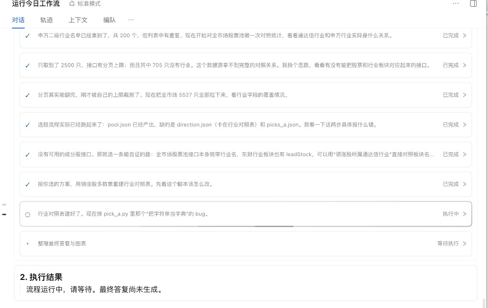

# dsh-stage-chat

[中文](README.md) · **English**

dsh-stage-chat is a stage-based conversation view for DeepSeek Harness. It replaces the built-in Chat view and organizes one turn into three sections, in order: execution, result, and items awaiting confirmation.

| Item | Value |
| --- | --- |
| Package | `dsh-stage-chat` |
| Version | 0.1.4 |
| Compatibility | DeepSeek Harness 0.2.2-rc.5 and earlier |
| Mount point | `chat`, priority `-100` |
| License | [MIT](LICENSE) |

## Interface

The execution section states the active stage and lists the steps that have already returned, each with its status.



The result of the same turn is a separate section. A step still in progress is marked running. A step that has not started is marked waiting.



The full interaction is in the [demo video](docs/demo.mp4).

## Installation

DeepSeek Harness must already be installed.

```bash
dsh plugin --profile web add github:AlienwareBoy/dsh-stage-chat
```

Reload the client after installation. The composer, approvals, and the other views remain part of Harness. Colors follow the host light theme, dark theme, and system setting.

On the desktop app, install the plugin from the in-app plugin manager and reload the window.

## Presentation

- **Execution** contains the public stage notes and the tool calls that occurred inside that stage. When the model does not name a stage, those calls are filed under “Doing the task.”
- **Result** is the final text written by the model. A successful tool call is not a result. While the turn is still running the result section stays empty; the “Preparing the final reply and charts” stage alone expresses the waiting state.
- **Awaiting confirmation** appears only when an item is pending. Confirmation stays in the Harness composer.

Only the active stage shows the moving highlight. The highlight stops when that stage finishes, fails, is interrupted, or waits for approval. It does not play when the system setting “Reduce motion” is enabled.

Each turn shows its start time at the top left: hours and minutes today, prefixed with “昨天/yesterday” for yesterday, day-level inside the past week, and the full timestamp beyond a week. A running turn also shows its elapsed time.

The left side of the session is a rail of turn anchors. An anchor enlarges as the pointer approaches. Hovering shows that turn’s prompt and reply summary. Activating an anchor jumps to the turn.

Mermaid fences in the result are rendered locally, with source view and zoom. The result section can copy or download the full Markdown of the turn, and the top of the view can copy or download the Markdown of the whole session. It shows public text, tool arguments, and tool results.

## Configuration

Open **Conversation display** in the Harness settings. Adjust the colors, edit the configuration JSON and the reply rules, then save. The reply rules take effect on the next model request and do not rewrite the rest of the system prompt. The reply rules may be empty.

Two behavior toggles apply together with the reply rules: **Strict stage messages** requires a public stage-named message before every tool call, and **Required charts** requires a Mermaid chart for trend, comparison, and flow replies. Both are on by default.

## Build from source

```bash
npm install
npm run typecheck
npm run build
npm test
npm pack
```

These commands do not start Harness. The packed archive can be installed locally:

```bash
dsh plugin --profile web add ./dsh-stage-chat-0.1.4.tgz
```
