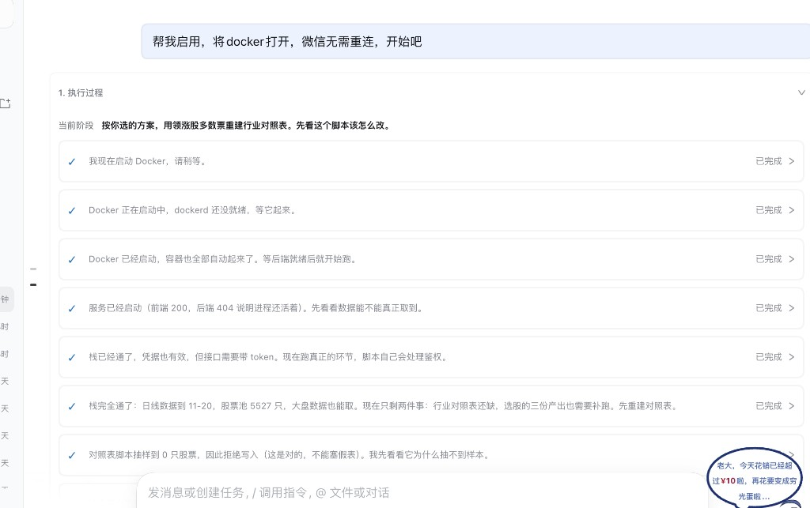
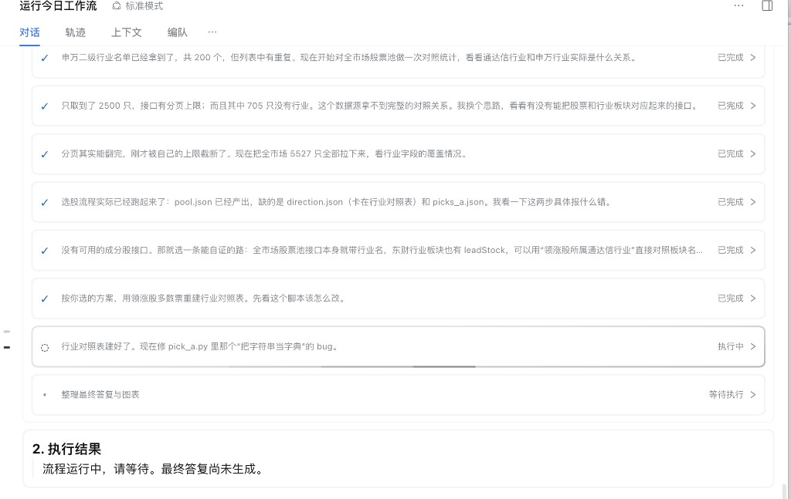

# dsh-stage-chat

**中文** · [English](README.en.md)

dsh-stage-chat 是 DeepSeek Harness 的阶段式对话视图。插件替换内置「对话」，将一轮回复按顺序组织为三段：执行过程、执行结果、待确认事项。

| 项目 | 说明 |
| --- | --- |
| 包名 | `dsh-stage-chat` |
| 当前版本 | 0.1.3 |
| 兼容范围 | DeepSeek Harness 0.2.2-rc.5 及更早版本 |
| 接入位置 | `chat`，优先级 `-100` |
| 许可 | [MIT](LICENSE) |

## 界面

执行过程给出当前阶段说明，并列出已经返回的步骤及其状态。



同一轮的执行结果单独成节。进行中的步骤标记为「执行中」，尚未开始的步骤标记为「等待执行」。



完整交互过程见 [演示视频](docs/demo.mp4)。

## 安装

本机需已安装 DeepSeek Harness。

```bash
dsh plugin --profile web add github:AlienwareBoy/dsh-stage-chat
```

安装完成后重新加载客户端。输入区、审批及其他视图仍由 Harness 提供。配色跟随宿主的浅色、深色与系统设置。

桌面版通过应用内插件管理安装，安装后重新加载窗口。

## 呈现规则

- **执行过程**收录公开的阶段说明，以及该阶段内实际发生的工具调用。模型未提供阶段说明时，相关调用归入「执行任务」。
- **执行结果**采用模型最终写出的正文。工具调用成功不构成执行结果。
- **待确认事项**仅在存在待处理项时显示。确认操作仍在 Harness 输入区完成。

同一时刻只有当前阶段显示流光。该阶段完成、失败、中断或进入审批等待后，动画停止。系统开启「减少动态效果」时不播放动画。

会话左侧为轮次锚点。指针接近时锚点放大；悬停显示该轮的提示与答复摘要；激活后跳转到对应位置。

执行结果中的 Mermaid 代码块在本地渲染，支持查看源码、缩放图示，以及下载该轮的完整 Markdown。视图仅展示公开文本、工具参数与返回内容。

## 配置

在 Harness 设置中打开 **对话显示**。可调整配色，编辑配置 JSON 与回复规则，然后保存。回复规则自下一次模型请求起生效，不改写其余系统提示词。回复规则允许为空。

## 从源码构建

```bash
npm install
npm run typecheck
npm run build
npm test
npm pack
```

上述命令不会启动 Harness。生成的安装包可在本地安装：

```bash
dsh plugin --profile web add ./dsh-stage-chat-0.1.3.tgz
```
